# Interactive Mobile IP Handoff and Routing Simulator

Course project for MCA263D3 Advanced Computer Networks, team of three.

This is a Mobile IPv4 simulator built around foreign agents, as Request for Comments (RFC) 3344 describes them. Every network entity is its own Python process. Every packet they exchange is a real Internet Protocol version 4 (IPv4) datagram, byte for byte, with correct header checksums, carried inside a localhost User Datagram Protocol (UDP) packet. A Node.js gateway streams every event to a single-screen network operations console written in React. From that console you can drag the mobile node between networks and watch agent discovery, registration, tunneling and route optimization happen packet by packet.

It runs on Windows 10 and 11 without administrator rights, and equally on Linux and macOS. The Python agents use the standard library only.

## What it shows

- Agent discovery: periodic Agent Advertisements, Agent Solicitation on attach, sequence number rollover from 0xffff to 256 and agent reboot detection.
- Movement detection with two selectable rules, advertisement lifetime and network prefix, with the detection time measured for every handoff.
- Registration through the foreign agent (FA) with keyed-MD5 authentication in prefix+suffix mode, timestamp or nonce replay protection, FA denial codes 64 to 88, home agent (HA) codes 0, 1 and 128 to 139, renewal, retransmission with exponential backoff and deregistration on return home.
- Three tunnel encapsulations: IP-in-IP, Minimal Encapsulation and Generic Routing Encapsulation (GRE), with the overhead of each measured live.
- Reverse tunneling, and an ingress filter on the backbone that shows why it is needed.
- Triangle routing against route optimization, using Binding Update, Binding Acknowledge, Binding Warning and Binding Request, plus smooth handoff through the previous FA.
- A Wireshark-style inspector and a real libpcap export that opens in Wireshark.
- Quality of service, judged against the standards: voice, video and chat flows measured for one-way delay, RFC 3550 jitter, loss, late loss and interruption time, with a G.107 E-model score for the call and a Good, Fair or Poor verdict against ITU-T G.1010, Y.1541 and G.114 targets.
- Real-world coverage: a Metro ride through a 20 second tunnel with no signal at all, five switchable rescue features, and a side by side result of the same ride with them off and on.

## Architecture

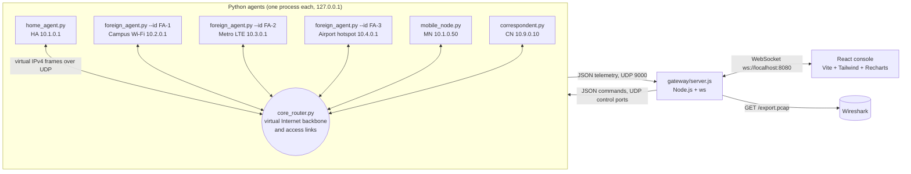

The core router is the medium for everything. Each agent sends its frames to the router with a small 8-byte virtual link header, the equivalent of an Ethernet header, which says whether the frame is for the backbone, for one station on the same link, or for every station on the link. The router does the longest-prefix lookup, decrements the TTL (time to live), applies the configured delay and loss, resolves the destination with its per-link Address Resolution Protocol (ARP) cache, and mirrors every frame to telemetry as JavaScript Object Notation (JSON) with a decoded protocol tree and the raw bytes.

A handoff is the mobile node (MN) telling the router that it has associated with another link. Everything after that, solicitation, movement detection and registration, is ordinary Mobile IP signalling.

## Topology and addressing

| Entity | Process | Network | Address | Data port | Control port |
|---|---|---|---|---|---|
| Core router | `agents/core_router.py` | backbone | 10.0.0.1 | 47000 | 47100 |
| Home agent (HA) | `agents/home_agent.py` | Home Network 10.1.0.0/24 | 10.1.0.1 | 47001 | 47101 |
| FA-1 | `agents/foreign_agent.py --id FA-1` | Campus Wi-Fi 10.2.0.0/24 | 10.2.0.1 | 47002 | 47102 |
| FA-2 | `agents/foreign_agent.py --id FA-2` | Metro LTE cell 10.3.0.0/24 | 10.3.0.1 | 47003 | 47103 |
| FA-3 | `agents/foreign_agent.py --id FA-3` | Airport hotspot 10.4.0.0/24 | 10.4.0.1 | 47004 | 47104 |
| Mobile node (MN) | `agents/mobile_node.py` | home 10.1.0.0/24 | 10.1.0.50 | 47005 | 47105 |
| Correspondent node (CN) | `agents/correspondent.py` | Server network 10.9.0.0/24 | 10.9.0.10 | 47006 | 47106 |
| Gateway | `gateway/server.js` | | | UDP 9000 telemetry | HTTP and WebSocket 8080 |
| Dashboard (dev) | Vite | | | | 5173 |

Link delays: home 2 ms, Campus Wi-Fi 4 ms, Metro LTE 15 ms, Airport 8 ms, server network 2 ms, backbone 20 ms. FA-3 does not offer GRE and grants at most 20 s, so it also exercises the fallbacks. Every value, port and key lives in `config/topology.json`. No other file hard-codes a port.

Registration uses UDP port 434 inside the virtual datagrams. Nothing binds a real port below 1024, which is why no privileges are needed on any operating system.

## Install and run on Windows

Prerequisites: Python 3.10 or newer and Node.js 18 or newer, both on PATH. The agents need nothing from pip.

```bat
cd C:\MobileIP-Handoff-Simulator
cd gateway
npm install
cd ..\frontend
npm install
cd ..
start.bat
```

Then open http://localhost:5173. Press Ctrl+C in the console window to stop every process. Windows then asks "Terminate batch job (Y/N)?", which is normal for any batch file, so answer Y.

`start.bat --prod` builds the dashboard once and lets the gateway serve it on http://localhost:8080, with no Vite process. `python run_all.py` does the same as `start.bat` without the batch wrapper. On Linux or macOS use `./start.sh`.

`run_all.py` runs `npm install` itself the first time if `node_modules` is missing.

## Story mode and Expert mode

The console opens in Story mode, a single screen for someone who has never heard of Mobile IP. The toggle at the top switches to Expert mode, which is the full console described in the next section. Both modes read the same live state, so switching in the middle of the tour shows the same simulation, and the packet inspector holds the packets that Story mode drew as envelopes.

- Scene: Home with its router (the home agent), Campus Wi-Fi, the Metro and the Airport, with the Internet and the video server above. Click a place, or use Walk to..., and Priya walks there. The real handoff is sent when she arrives.
- Phone: three apps, each with a small status light. The video plays a picture that freezes, with a buffering spinner, exactly when the real video flow stops, and Frames lost counts up. The call shows a sound meter that goes flat when the voice flow stops, and says Clear, Choppy, Cutting out or Silent. The chat says Delivered, or Sending when a message is still waiting for its acknowledgement. Above the phone a badge says Smooth, A little choppy or Breaking up with one plain sentence, and no numbers. Under the phone is the network Priya is reachable through right now.
- Metro ride tab: the same screen with a route from Home through Campus and Station A, a tunnel, Station B and the Airport. The train is the moving marker. Above it are signal bars and the network name, and in the tunnel the bars are empty. Start the ride, and switch the five rescue tools on one at a time. Each has one plain sentence.
- Envelopes: at most one per second, along the path the packets actually take. A plain envelope is a normal packet. An envelope inside an envelope is a tunnelled one, from the home router to Priya's network, or from the server once Shorter path is on. Replies take the short way back unless reverse tunnelling is on.
- Narrator: one or two plain-English sentences at the bottom, written from the real protocol events, with the last eight in the strip on the right. The technical explanations stay in Expert mode under Protocol walkthrough.
- Controls: Walk to..., Smooth handoff, Shorter path (route optimization) and Speed. The video, the call and the chat start by themselves.
- Start the tour runs `config/scenarios/7_story_tour.json`, thirteen chapters: discovery, registration and the tunnel at the campus, two trips to the Metro without and with Smooth handoff, then Shorter path and the drop in delay, and last two Metro ride chapters, the first with every rescue tool off and the second with all five on. The first eleven take about two minutes and each Metro ride chapter about 95 seconds. Next and Back jump between chapters, and each chapter carries its own setup, so a jump lands in the right state. Skip stops the tour.

Story mode screenshots, at 1920 x 1080: at home, in the middle of a handoff with frames lost, and with Shorter path on.

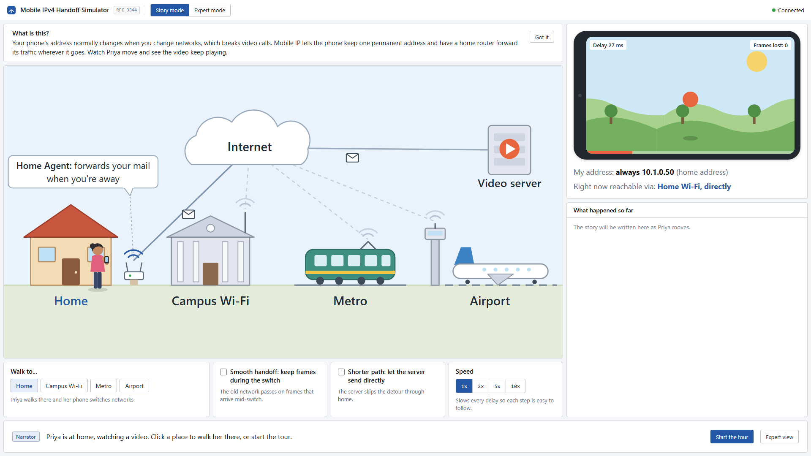

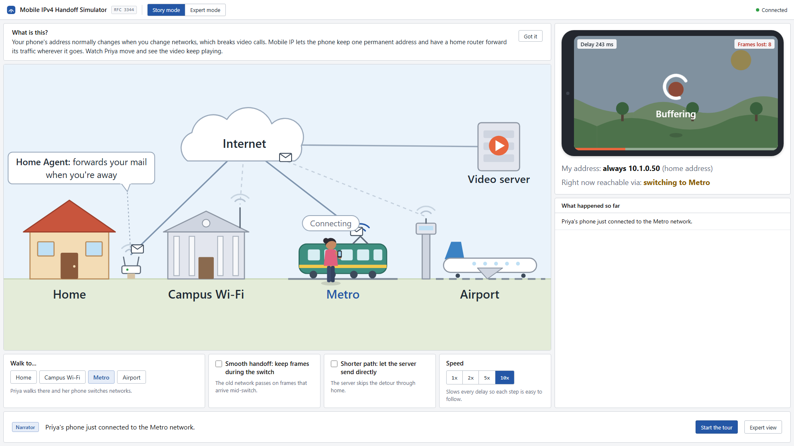

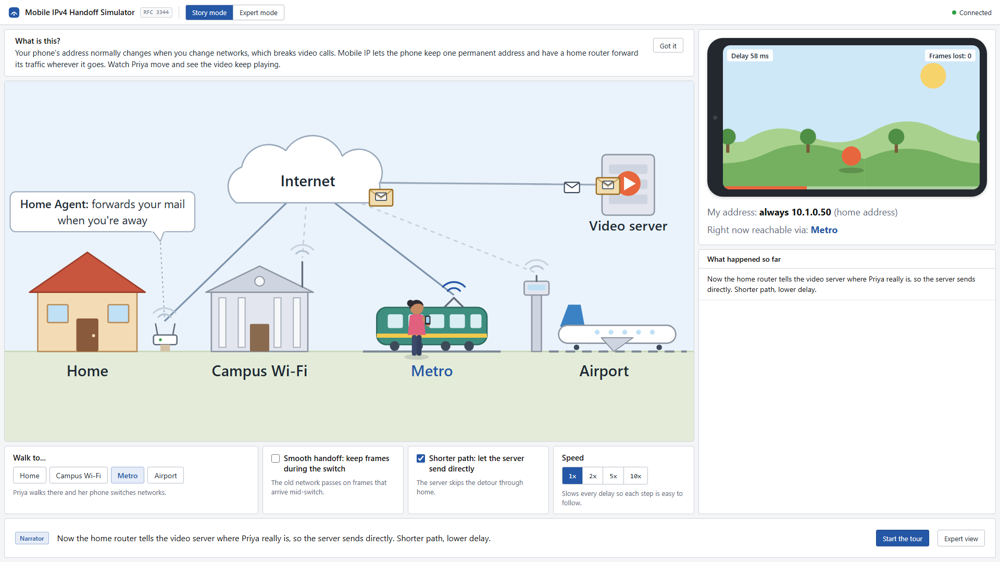

## Using the console

- Toolbar: Play, Pause, Step and Reset as icon buttons, a speed control from 1x to 20x that multiplies every link delay so packets can be followed by eye, the time elapsed since the last Reset, the scenario picker with Run and Stop, the Learn mode check box, the Quality drawer (gauge icon) and the Analytics drawer (chart icon), and the gateway connection status at the far right.
- Centre: the topology map, which takes most of the screen. The Internet cloud sits in the middle with the home and server networks above it and the three foreign networks below. Each network keeps its name and prefix in its top-left corner. In a foreign network the FA sits in the left half and the MN has a reserved slot in the right half, so the two never cover each other. Each link is labelled with its delay beside its midpoint, and a delay label that would touch any other label is left out (the value is still under Link conditions). Drag the MN onto another network to trigger a real handoff. Dots follow the links each datagram actually crossed: grey advertisements, amber registration, purple tunneled data, green plain data, cyan binding updates, and red with an X where a packet was dropped. Curved pipes show the HA tunnel in purple, the CN direct tunnel in cyan, the reverse tunnel in orange and smooth handoff forwarding in yellow, each named with its encapsulation on a label next to the cloud. The legend sits under the map. The router's forwarded and dropped counters are in the Agent state panel.
- Left: collapsible groups. Mobility has the four networks, with the current one highlighted. Protocol options are check boxes with a one-line hint each. Tunnel and detection holds the encapsulation, the movement rule and the advertisement interval. Link conditions has delay and loss per link. Traffic, Security (replay protection, the two demos, a forced lifetime) and Agent tools (reboot, sequence jump) follow.
- Right: the MN state as a stepper from At home to Registered away, with Renewing and Deregistering shown as a badge, and the MN details. Binding tables holds the HA mobility bindings with lifetime bars and each FA's visitor list. The CN binding cache and the core router counters follow.
- Bottom: a panel that collapses to its header bar, with three tabs. Packets is the packet inspector. Protocol events is the agents' event log. Protocol walkthrough lists the Learn mode explanations, one row per protocol step with the node, the RFC section, a headline and the explanation, newest at the bottom. Switching Learn mode on brings this tab to the front. In Packets, rows are tinted by packet type. The filter accepts free text such as `reg`, `icmp`, `tunnel` or `drop`, field tests such as `node==FA-2`, `src==10.1.0.50` or `type==bu`, and negation such as `!adv`. Click a row for the protocol tree and the hex and ASCII dump, and hover a field to highlight its bytes. "Download .pcap" saves the capture.
- Analytics: latency per packet with triangle and optimized overlaid, the handoff timeline split into detection and registration, packets lost and rescued per handoff, encapsulation overhead, the scenario phase table and comma-separated values (CSV) export.

The URL hash `#analytics` opens the drawer on load and `#inspect=reg` selects the newest matching packet. We use both for screenshots in the report.

## Quality of service

Three flows run from the correspondent to the mobile node, each with its own port, flow id and profile in `config/traffic.json`.

| Flow | What it is | Judged by |
|---|---|---|
| Voice | G.711-like, a 160-byte payload every 20 ms, 50 packets a second | MOS from the E-model, one-way delay against G.114, loss and jitter |
| Video | 10 to 25 frames a second, a larger key frame every second, each frame split into packets of at most 1000 bytes | freeze count and total freeze time, Y.1541 class 1, loss and delay |
| Chat | a short message every 3 to 5 s, acknowledged, retransmitted until acknowledged | delivery time and whether anything was lost |

The mobile node measures, over a sliding window and over the whole run, the one-way delay (mean, 95th percentile, maximum), the RFC 3550 jitter, the loss ratio, the longest loss burst, out-of-order packets, late packets (arrived after the playout deadline, counted as lost exactly as a real player would) and the interruption time (last packet on the old link to first on the new). The playout buffer is adaptive and sized from the jitter, or fixed, in `config/traffic.json`.

Every target is in `config/qos_targets.json` with a source and a `verified` flag. A flow gets Good when every check passes, Fair when a Y.1541 objective is missed but the G.1010 limit is not, and Poor when a limit is passed or nothing has arrived for a second. The reason is in words, for example "jitter 62 ms is above the 50 ms limit".

- Expert mode, Quality button: live numbers for the three flows, the compliance table (metric, measured, target, result, source), charts of delay, jitter and MOS with the handoffs as dashed lines and dead zones as grey bands, the interruption list, and the QoS timeline as a CSV download (`/export/qos.csv` on the gateway).
- Story mode: only the badge and the three app lights.

The standards used, the E-model simplifications and the numbers we could not verify from the documents are listed in `docs/PROTOCOL_NOTES.md`.

## The Metro ride

The route is in `config/coverage.json`: Home, Campus, Station A, a tunnel of 500 m, Station B and the Airport, 2150 m at 25 m/s, so the tunnel takes 20 s and the whole ride about 86 s. Each network has a signal in dBm that depends on position. Where every network is below -100 dBm the core router drops everything to and from the phone. With every feature off, the phone moves to whichever network is strongest right now.

The five switchable features, in Expert mode under Rescue features and in Story mode under the Metro ride tab:

| Feature | One line | Where it comes from |
|---|---|---|
| Smart handoff | Switch only when the signal is weak and another network is clearly stronger for a moment. | our own policy |
| Two networks at once | While two networks overlap, stay on both, the home router sends a copy to each and the phone drops the duplicate. | RFC 3344 S flag |
| Hold and forward | While the phone has no signal the home router keeps its packets and hands them over when it is back. Calls are not kept for long, video for about 2 s, chat is kept. | our own extension, not RFC 3344 |
| Adaptive video | The server sends a smaller picture when the phone reports loss or a weak signal, then restores it. | our own feedback loop |
| Fast re-registration | The moment the signal returns the phone announces itself instead of waiting for the next beacon. | RFC 3344 allows it, the trigger is ours |

### Run the Metro ride

1. `start.bat` (or `python run_all.py`) and open http://localhost:5173.
2. Story mode: open the Metro ride tab and press Start the ride. About 86 seconds.
3. Expert mode: pick Metro ride (current switches) in the scenario list and press Run, or open Quality and press Run the ride. About 105 seconds including the start and the summary.
4. The comparison: pick Metro ride, features off then on and press Run, or press Compare: off then on in the Quality drawer. About 3.5 minutes. When it ends the Quality drawer shows the two runs side by side under Metro ride result, with a CSV download.

### Result

The ride was run twice with each setting, on the same Windows laptop, 86 s of riding plus 8 s to settle. The signal at every position is identical in all four runs, so the differences come from the switches and from timing.

| Measure | Off, run 1 | Off, run 2 | All on, run 1 | All on, run 2 |
|---|---|---|---|---|
| Handoffs | 15 | 19 | 3 | 3 |
| Voice interruptions of 100 ms or more (count, total) | 11, 21.7 s | 19, 22.8 s | 3, 20.8 s | 7, 21.1 s |
| Voice loss including late packets | 21.6 % | 22.2 % | 20.6 % | 20.3 % |
| Voice worst MOS, whole ride | 1.00 | 1.00 | 1.00 | 1.00 |
| Voice worst MOS outside the tunnel | 2.03 | 1.37 | 2.56 | 3.38 |
| Voice time with MOS below 3.1 | 32.5 s | 33.2 s | 28.2 s | 23.8 s |
| Video frames lost | 699 of 2547 (27.4 %) | 730 of 2546 (28.7 %) | 269 of 1564 (17.2 %) | 249 of 1545 (16.1 %) |
| Video picture frozen (total, freezes) | 28.1 s in 9 | 29.6 s in 14 | 23.0 s in 6 | 23.9 s in 5 |
| Chat messages lost | 0 of 25 | 0 of 25 | 0 of 25 | 0 of 25 |
| Chat slowest delivery | 23.3 s | 23.4 s | 17.8 s | 17.9 s |
| Chat mean delivery | 3.25 s | 3.22 s | 2.18 s | 1.96 s |
| Chat messages that needed a retransmission | 6 | 7 | 2 | 1 |
| Back after the tunnel, voice, video, chat | 0.34, 0.34, 1.46 s | 0.07, 0.09, 0.29 s | 0.16, 0.24, 0.15 s | 0.17, 0.23, 0.16 s |
| Verdict, voice, video, chat | Poor, Poor, Poor | Poor, Poor, Poor | Poor, Poor, Poor | Poor, Poor, Poor |

Reading it honestly:

- The tunnel is 20 s with no signal. Sound and picture produced in it are gone, and no feature brings them back. That is why voice loss is about 20 per cent and the worst MOS is 1.00 in every run, and why every flow is Poor over the whole ride.
- The clearest effect is the handoffs. The baseline makes 15 to 19 and flips back and forth at each cell edge. Smart handoff makes 3, one per cell. The baseline numbers move from run to run because the flips depend on timing. The settings with features on were steady.
- Video loses a smaller share of its frames (16 to 17 per cent against 27 to 29) and freezes for 5 to 6 s less. Part of that is the adaptive sender, which sends fewer frames while the signal is weak, so compare the shares and not the counts.
- Chat loses nothing in any run, because it is retransmitted. With hold and forward the messages are handed over at once when the phone returns, so the mean delivery time falls from about 3.2 s to about 2 s. The slowest message still waited most of the tunnel.
- Fast re-registration did not shorten the recovery of voice and video in our runs. The baseline's one-second discovery loop usually fires within a fraction of a second of the signal returning, so the time to recover is already short. The 0.07 s in baseline run 2 is luck.
- Hold and forward kept 1069 packets in run 1 and released 26: 12 chat messages, 7 voice and 7 video packets. The rest, 726 voice and 317 video packets, were older than their limit (150 ms and 2 s) and were dropped, as designed.
- The worst MOS outside the tunnel is the noisiest row. It depends on how many 100 ms gaps fall in one five-second window.

These are four runs and not a statistical study.


## Scenario walkthroughs

In Expert mode, pick a scenario in the top bar and press Run. Each one resets the simulation first and narrates its steps in the topology header and the event log.

1. Commuter. The MN goes home, Campus Wi-Fi, Metro LTE, Airport and home again, eight seconds apart, with the video stream running. Watch the binding move and the losses per handoff in Analytics.
2. Ping-pong edge. The MN flaps between FA-1 and FA-2 every 1.2 s, first with prefix-based detection and then with lifetime-based detection. The prefix rule follows every flap. The lifetime rule lags because it waits up to three advertisement intervals.
3. Wrong shared key. The MN registers at Metro LTE, then sends one Registration Request signed with a wrong key. The HA answers code 131 and the binding table keeps the old, valid entry.
4. Replayed request. The MN re-sends its previous Registration Request unchanged. The HA answers 133 in timestamp mode, then again in nonce mode.
5. Ingress filter. With filtering on, the MN's replies, sent by triangle routing with source 10.1.0.50 from 10.2.0.0/24, die at the backbone and the CN reply counter stops. Turning on reverse tunneling sends them through the HA and they arrive again.
6. Triangle vs optimized. The same stream is measured for ten seconds each way. In our runs triangle routing averaged about 84 ms over 3 segments (stretch 1.5) and route optimization about 58 ms over 2 segments (stretch 1.0).
7. Story mode tour. Thirteen chapters, the last two on the Metro ride.
8. Metro ride (current switches), and 9. Metro ride, features off then on. Both start with voice, video and chat running and the train at Home.

## Screenshots

Main console, MN at home:

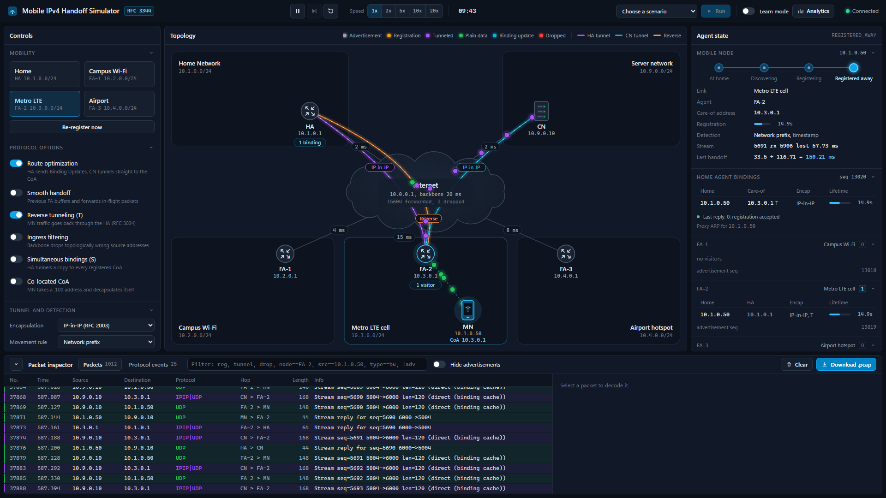

MN at the Airport (FA-3) with Learn mode on. The walkthrough was stepped with Pause and Step so it stops at six entries, and the panel is scrolled to the newest:

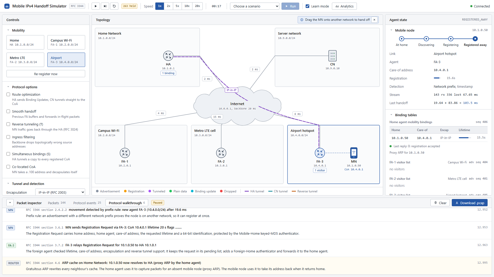

Analytics drawer:

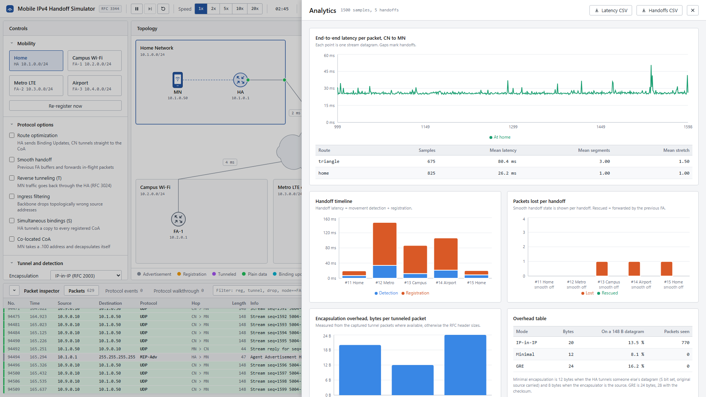

Quality drawer at 1920 x 1080, paused in the middle of the tunnel: voice and video Poor with no packets for 15.7 s, chat still Good, and the compliance table with the source of each target. The grey bands in the charts are dead zones and the dashed lines are handoffs:

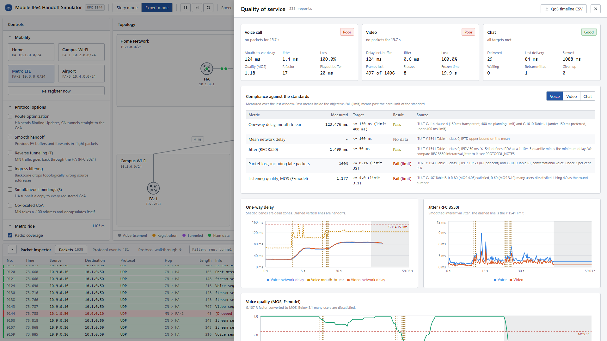

The Metro ride result at 1366 x 768, features off against all on, from the second pair of runs in the table above:

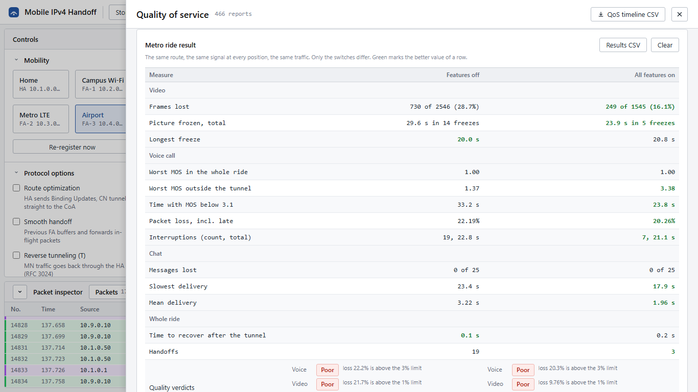

Story mode, Metro ride tab, at 1920 x 1080. In the tunnel the badge says Breaking up, the video is frozen, the call is silent and the chat is sending again. After the tunnel, on the way to the airport hotspot:

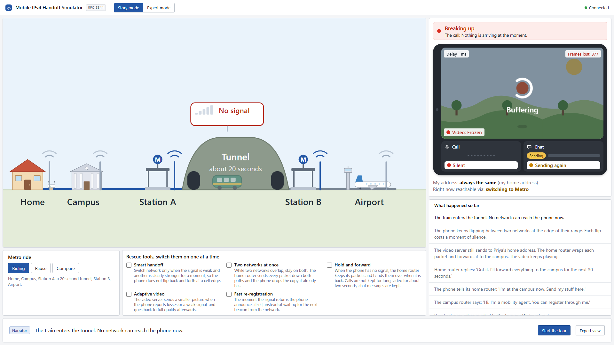

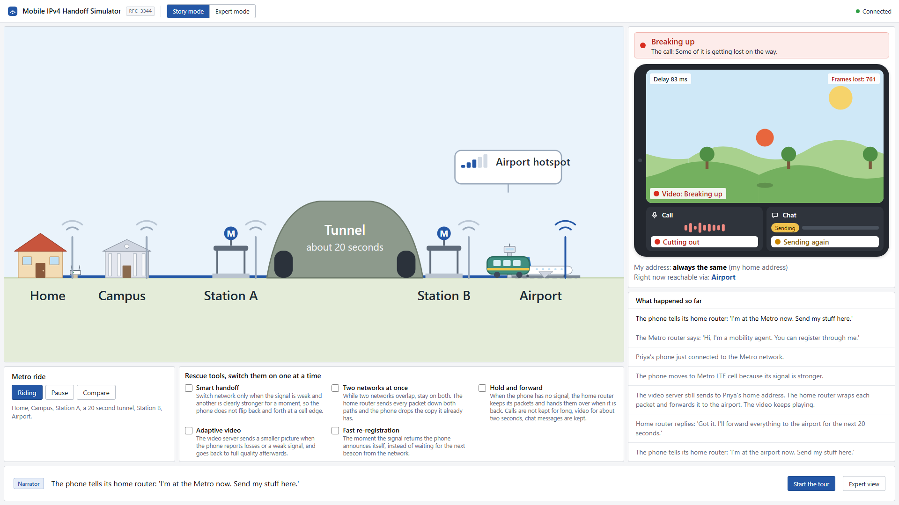

Packet inspector enlarged and paused, with an IP-in-IP packet from the HA to FA-2 selected. The outer header is folded so the encapsulation and inner header show, above the hex dump. The map scales down to make room:

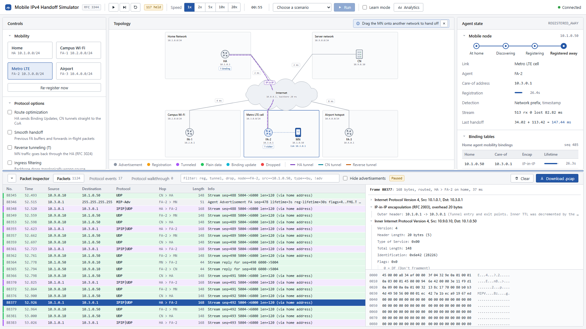

## Folder structure

```
agents/            Python agents, standard library only
  mip/             shared library: ipv4, messages, encap, auth, policy, decode, link, node, telemetry, config, clock
                   qos, qosmgr (measurement), traffic (voice, video, chat sources), radio and radiomodel (coverage)
config/            topology.json, scenarios/*.json and the new files:
                   qos_targets.json (every target with its source), traffic.json (flows, ports, playout, feedback),
                   coverage.json (route, cells, dead zones), resilience.json (the five features and their settings)
gateway/           Node.js WebSocket gateway, metrics, scenario runner, pcap writer
frontend/          React 18 + Vite + Tailwind console
tools/             debugging aids: telemetry tail, command sender, start and stop scripts
docs/              protocol notes, team split, viva guide
run_all.py         launcher, start.bat and start.sh wrap it
```

## Debugging from the terminal

With the gateway stopped, `python tools/telemetry_tail.py` prints agent events in the terminal. Add `--packets` to include every router frame. `python tools/send_command.py MN handoff "{\"link\":\"fa2\"}"` sends one control command. `bash tools/start_agents.sh` starts only the agents, and `powershell -File tools/stop_agents.ps1` stops anything left running.

## References

- RFC 3344, IP Mobility Support for IPv4 (C. Perkins, 2002)
- RFC 2003, IP Encapsulation within IP
- RFC 2004, Minimal Encapsulation within IP
- RFC 1701 and RFC 2784, Generic Routing Encapsulation
- RFC 3024, Reverse Tunneling for Mobile IP, revised
- C. Perkins and D. Johnson, Route Optimization in Mobile IP, IETF Internet-Draft draft-ietf-mobileip-optim
- RFC 1256, ICMP Router Discovery Messages
- RFC 826, An Ethernet Address Resolution Protocol
- RFC 2827, Network Ingress Filtering
- RFC 3550, RTP, section 6.4.1 and appendix A.8 (interarrival jitter)
- ITU-T G.1010 (2001), End-user multimedia QoS categories, Appendix I
- ITU-T Y.1541 (2011), Network performance objectives for IP-based services
- ITU-T G.114 (2003), One-way transmission time
- ITU-T G.107 (2015), The E-model, and G.113 (2024), Appendix I
- R. Ramjee, J. Kurose, D. Towsley and H. Schulzrinne, Adaptive playout mechanisms for packetized audio applications in wide-area networks, IEEE INFOCOM 1994

What is implemented exactly and what is simplified is listed in `docs/PROTOCOL_NOTES.md`.
