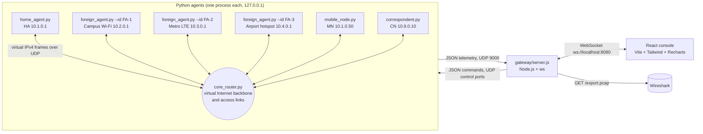
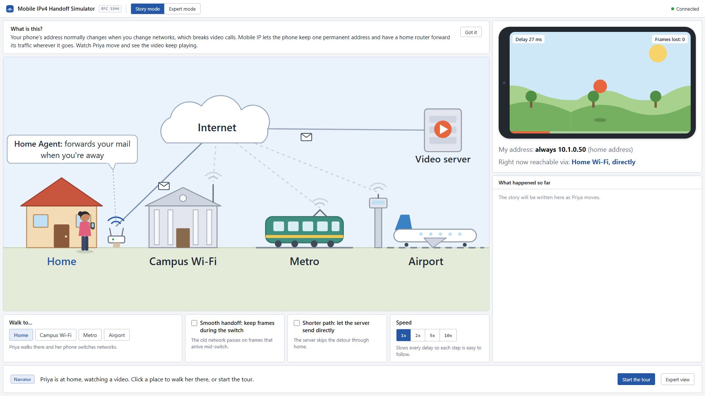
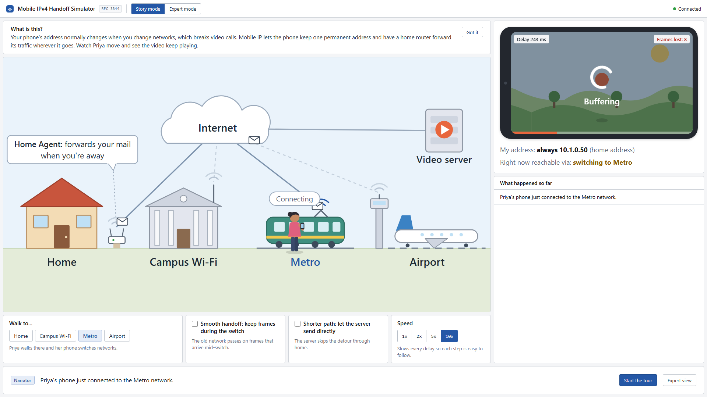
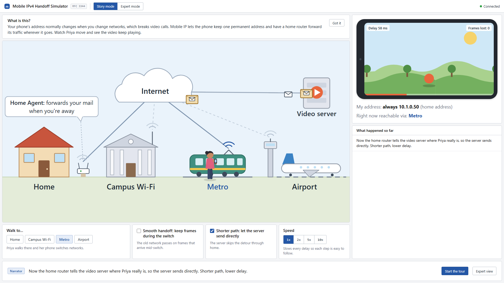
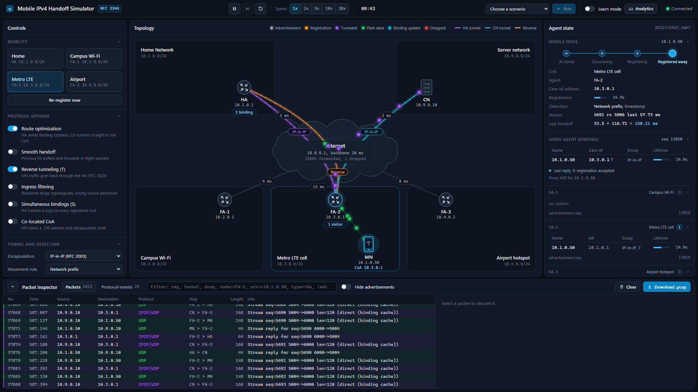
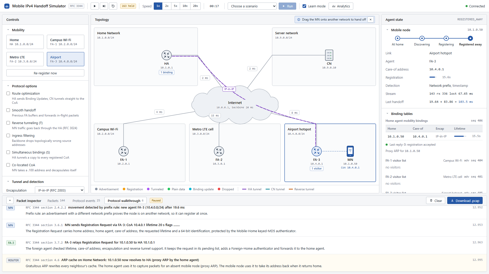
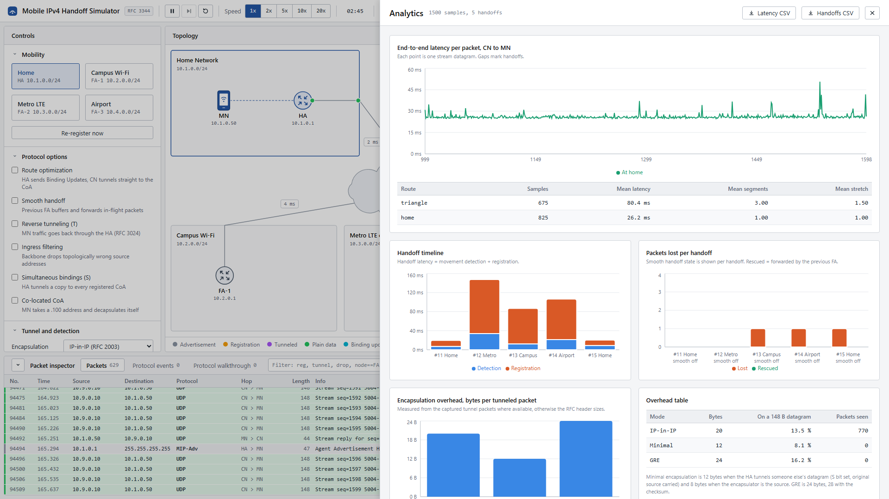
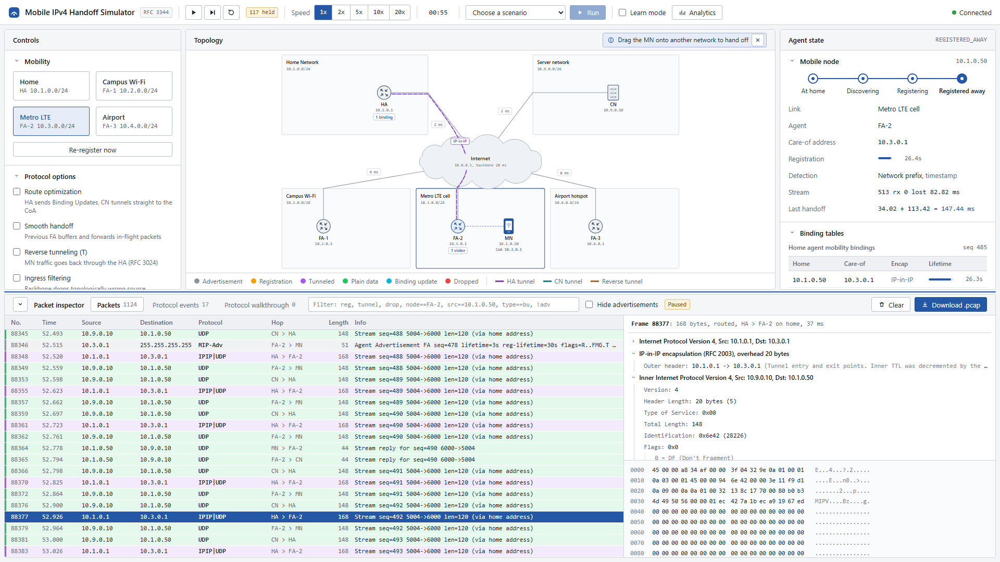

# Interactive Mobile IP Handoff and Routing Simulator

Course project for MCA263D3 Advanced Computer Networks, team of three.

This is a Mobile IPv4 simulator built around foreign agents, as Request for Comments (RFC) 3344 describes them. Every network entity is its own Python process. Every packet they exchange is a real Internet Protocol version 4 (IPv4) datagram, byte for byte, with correct header checksums, carried inside a localhost User Datagram Protocol (UDP) packet. A Node.js gateway streams every event to a single-screen network operations console written in React. From that console you can drag the mobile node between networks and watch agent discovery, registration, tunneling and route optimization happen packet by packet.

It runs on Windows 10 and 11 without administrator rights, and equally on Linux and macOS. The Python agents use the standard library only.

## What it shows

- Agent discovery: periodic Agent Advertisements, Agent Solicitation on attach, sequence number rollover from 0xffff to 256 and agent reboot detection.
- Movement detection with two selectable rules, advertisement lifetime and network prefix, with the detection time measured for every handoff.
- Registration through the foreign agent (FA) with keyed-MD5 authentication in prefix+suffix mode, timestamp or nonce replay protection, FA denial codes 64 to 88, home agent (HA) codes 0, 1 and 128 to 139, renewal, retransmission with exponential backoff and deregistration on return home.
- Three tunnel encapsulations: IP-in-IP, Minimal Encapsulation and Generic Routing Encapsulation (GRE), with the overhead of each measured live.
- Reverse tunneling, and an ingress filter on the backbone that shows why it is needed.
- Triangle routing against route optimization, using Binding Update, Binding Acknowledge, Binding Warning and Binding Request, plus smooth handoff through the previous FA.
- A Wireshark-style inspector and a real libpcap export that opens in Wireshark.

## Architecture



The core router is the medium for everything. Each agent sends its frames to the router with a small 8-byte virtual link header, the equivalent of an Ethernet header, which says whether the frame is for the backbone, for one station on the same link, or for every station on the link. The router does the longest-prefix lookup, decrements the TTL (time to live), applies the configured delay and loss, resolves the destination with its per-link Address Resolution Protocol (ARP) cache, and mirrors every frame to telemetry as JavaScript Object Notation (JSON) with a decoded protocol tree and the raw bytes.

A handoff is the mobile node (MN) telling the router that it has associated with another link. Everything after that, solicitation, movement detection and registration, is ordinary Mobile IP signalling.

## Topology and addressing

| Entity | Process | Network | Address | Data port | Control port |
|---|---|---|---|---|---|
| Core router | `agents/core_router.py` | backbone | 10.0.0.1 | 47000 | 47100 |
| Home agent (HA) | `agents/home_agent.py` | Home Network 10.1.0.0/24 | 10.1.0.1 | 47001 | 47101 |
| FA-1 | `agents/foreign_agent.py --id FA-1` | Campus Wi-Fi 10.2.0.0/24 | 10.2.0.1 | 47002 | 47102 |
| FA-2 | `agents/foreign_agent.py --id FA-2` | Metro LTE cell 10.3.0.0/24 | 10.3.0.1 | 47003 | 47103 |
| FA-3 | `agents/foreign_agent.py --id FA-3` | Airport hotspot 10.4.0.0/24 | 10.4.0.1 | 47004 | 47104 |
| Mobile node (MN) | `agents/mobile_node.py` | home 10.1.0.0/24 | 10.1.0.50 | 47005 | 47105 |
| Correspondent node (CN) | `agents/correspondent.py` | Server network 10.9.0.0/24 | 10.9.0.10 | 47006 | 47106 |
| Gateway | `gateway/server.js` | | | UDP 9000 telemetry | HTTP and WebSocket 8080 |
| Dashboard (dev) | Vite | | | | 5173 |

Link delays: home 2 ms, Campus Wi-Fi 4 ms, Metro LTE 15 ms, Airport 8 ms, server network 2 ms, backbone 20 ms. FA-3 does not offer GRE and grants at most 20 s, so it also exercises the fallbacks. Every value, port and key lives in `config/topology.json`. No other file hard-codes a port.

Registration uses UDP port 434 inside the virtual datagrams. Nothing binds a real port below 1024, which is why no privileges are needed on any operating system.

## Install and run on Windows

Prerequisites: Python 3.10 or newer and Node.js 18 or newer, both on PATH. The agents need nothing from pip.

```bat
cd C:\MobileIP-Handoff-Simulator
cd gateway
npm install
cd ..\frontend
npm install
cd ..
start.bat
```

Then open http://localhost:5173. Press Ctrl+C in the console window to stop every process. Windows then asks "Terminate batch job (Y/N)?", which is normal for any batch file, so answer Y.

`start.bat --prod` builds the dashboard once and lets the gateway serve it on http://localhost:8080, with no Vite process. `python run_all.py` does the same as `start.bat` without the batch wrapper. On Linux or macOS use `./start.sh`.

`run_all.py` runs `npm install` itself the first time if `node_modules` is missing.

## Story mode and Expert mode

The console opens in Story mode, a single screen for someone who has never heard of Mobile IP. The toggle at the top switches to Expert mode, which is the full console described in the next section. Both modes read the same live state, so switching in the middle of the tour shows the same simulation, and the packet inspector holds the packets that Story mode drew as envelopes.

- Scene: Home with its router (the home agent), Campus Wi-Fi, the Metro and the Airport, with the Internet and the video server above. Click a place, or use Walk to..., and Priya walks there. The real handoff is sent when she arrives.
- Phone: a video that advances one frame for every stream datagram the mobile node really receives. When packets stop, the picture freezes, a buffering spinner appears and Frames lost counts up. Frames that turn up late through smooth handoff are taken back off the count. Under the phone are the permanent home address and the network Priya is reachable through right now.
- Envelopes: at most one per second, along the path the packets actually take. A plain envelope is a normal packet. An envelope inside an envelope is a tunnelled one, from the home router to Priya's network, or from the server once Shorter path is on. Replies take the short way back unless reverse tunnelling is on.
- Narrator: one or two plain-English sentences at the bottom, written from the real protocol events, with the last eight in the strip on the right. The technical explanations stay in Expert mode under Protocol walkthrough.
- Controls: Walk to..., Smooth handoff, Shorter path (route optimization) and Speed. The video stream starts by itself.
- Start the tour runs `config/scenarios/7_story_tour.json`, eleven chapters in about two minutes: discovery, registration and the tunnel at the campus, two trips to the Metro without and with Smooth handoff, then Shorter path and the drop in delay. Next and Back jump between chapters, and each chapter carries its own setup, so a jump lands in the right state. Skip stops the tour.

Story mode screenshots, at 1920 x 1080: at home, in the middle of a handoff with frames lost, and with Shorter path on.







## Using the console

- Toolbar: Play, Pause, Step and Reset as icon buttons, a speed control from 1x to 20x that multiplies every link delay so packets can be followed by eye, the time elapsed since the last Reset, the scenario picker with Run and Stop, the Learn mode check box, the Analytics drawer, and the gateway connection status at the far right.
- Centre: the topology map, which takes most of the screen. The Internet cloud sits in the middle with the home and server networks above it and the three foreign networks below. Each network keeps its name and prefix in its top-left corner. In a foreign network the FA sits in the left half and the MN has a reserved slot in the right half, so the two never cover each other. Each link is labelled with its delay beside its midpoint, and a delay label that would touch any other label is left out (the value is still under Link conditions). Drag the MN onto another network to trigger a real handoff. Dots follow the links each datagram actually crossed: grey advertisements, amber registration, purple tunneled data, green plain data, cyan binding updates, and red with an X where a packet was dropped. Curved pipes show the HA tunnel in purple, the CN direct tunnel in cyan, the reverse tunnel in orange and smooth handoff forwarding in yellow, each named with its encapsulation on a label next to the cloud. The legend sits under the map. The router's forwarded and dropped counters are in the Agent state panel.
- Left: collapsible groups. Mobility has the four networks, with the current one highlighted. Protocol options are check boxes with a one-line hint each. Tunnel and detection holds the encapsulation, the movement rule and the advertisement interval. Link conditions has delay and loss per link. Traffic, Security (replay protection, the two demos, a forced lifetime) and Agent tools (reboot, sequence jump) follow.
- Right: the MN state as a stepper from At home to Registered away, with Renewing and Deregistering shown as a badge, and the MN details. Binding tables holds the HA mobility bindings with lifetime bars and each FA's visitor list. The CN binding cache and the core router counters follow.
- Bottom: a panel that collapses to its header bar, with three tabs. Packets is the packet inspector. Protocol events is the agents' event log. Protocol walkthrough lists the Learn mode explanations, one row per protocol step with the node, the RFC section, a headline and the explanation, newest at the bottom. Switching Learn mode on brings this tab to the front. In Packets, rows are tinted by packet type. The filter accepts free text such as `reg`, `icmp`, `tunnel` or `drop`, field tests such as `node==FA-2`, `src==10.1.0.50` or `type==bu`, and negation such as `!adv`. Click a row for the protocol tree and the hex and ASCII dump, and hover a field to highlight its bytes. "Download .pcap" saves the capture.
- Analytics: latency per packet with triangle and optimized overlaid, the handoff timeline split into detection and registration, packets lost and rescued per handoff, encapsulation overhead, the scenario phase table and comma-separated values (CSV) export.

The URL hash `#analytics` opens the drawer on load and `#inspect=reg` selects the newest matching packet. We use both for screenshots in the report.

## Scenario walkthroughs

In Expert mode, pick a scenario in the top bar and press Run. Each one resets the simulation first and narrates its steps in the topology header and the event log.

1. Commuter. The MN goes home, Campus Wi-Fi, Metro LTE, Airport and home again, eight seconds apart, with the video stream running. Watch the binding move and the losses per handoff in Analytics.
2. Ping-pong edge. The MN flaps between FA-1 and FA-2 every 1.2 s, first with prefix-based detection and then with lifetime-based detection. The prefix rule follows every flap. The lifetime rule lags because it waits up to three advertisement intervals.
3. Wrong shared key. The MN registers at Metro LTE, then sends one Registration Request signed with a wrong key. The HA answers code 131 and the binding table keeps the old, valid entry.
4. Replayed request. The MN re-sends its previous Registration Request unchanged. The HA answers 133 in timestamp mode, then again in nonce mode.
5. Ingress filter. With filtering on, the MN's replies, sent by triangle routing with source 10.1.0.50 from 10.2.0.0/24, die at the backbone and the CN reply counter stops. Turning on reverse tunneling sends them through the HA and they arrive again.
6. Triangle vs optimized. The same stream is measured for ten seconds each way. In our runs triangle routing averaged about 84 ms over 3 segments (stretch 1.5) and route optimization about 58 ms over 2 segments (stretch 1.0).

## Screenshots

Main console, MN at home:



MN at the Airport (FA-3) with Learn mode on. The walkthrough was stepped with Pause and Step so it stops at six entries, and the panel is scrolled to the newest:



Analytics drawer:



Packet inspector enlarged and paused, with an IP-in-IP packet from the HA to FA-2 selected. The outer header is folded so the encapsulation and inner header show, above the hex dump. The map scales down to make room:



## Folder structure

```
agents/            Python agents, standard library only
  mip/             shared library: ipv4, messages, encap, auth, policy, decode, link, node, telemetry, config, clock
config/            topology.json and scenarios/*.json
gateway/           Node.js WebSocket gateway, metrics, scenario runner, pcap writer
frontend/          React 18 + Vite + Tailwind console
tools/             debugging aids: telemetry tail, command sender, start and stop scripts
docs/              protocol notes, team split, viva guide
run_all.py         launcher, start.bat and start.sh wrap it
```

## Debugging from the terminal

With the gateway stopped, `python tools/telemetry_tail.py` prints agent events in the terminal. Add `--packets` to include every router frame. `python tools/send_command.py MN handoff "{\"link\":\"fa2\"}"` sends one control command. `bash tools/start_agents.sh` starts only the agents, and `powershell -File tools/stop_agents.ps1` stops anything left running.

## References

- RFC 3344, IP Mobility Support for IPv4 (C. Perkins, 2002)
- RFC 2003, IP Encapsulation within IP
- RFC 2004, Minimal Encapsulation within IP
- RFC 1701 and RFC 2784, Generic Routing Encapsulation
- RFC 3024, Reverse Tunneling for Mobile IP, revised
- C. Perkins and D. Johnson, Route Optimization in Mobile IP, IETF Internet-Draft draft-ietf-mobileip-optim
- RFC 1256, ICMP Router Discovery Messages
- RFC 826, An Ethernet Address Resolution Protocol
- RFC 2827, Network Ingress Filtering

What is implemented exactly and what is simplified is listed in `docs/PROTOCOL_NOTES.md`.
